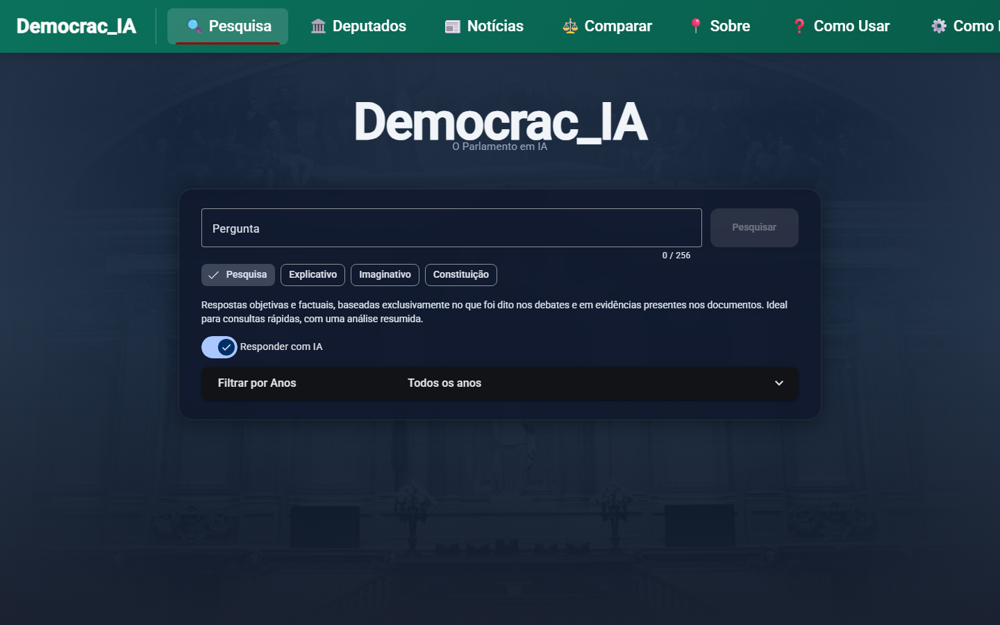

# O que é?




O Democrac_IA permite pesquisar e analisar debates parlamentares portugueses usando inteligência artificial. Consultar intervenções de deputados, analisar discussões políticas e explore a Constituição da República.


# Tecnologias
### Backend (Python + Flask)
- **Embeddings**: [BGE-M3](https://huggingface.co/BAAI/bge-m3) via SentenceTransformer
- **Vector Search**: FAISS (Meta AI)
- **LLM**: OSS 120B e Qwen 3.6  via [groqCloud](https://groq.com/)
- **Database**: SQLite
- **RAG Pipeline**: Retrieval-Augmented Generation

### Frontend (Angular 21)
- Material Design
- Markdown rendering
- Responsive design

### Dados
- **Fonte**: [debates.parlamento.pt](https://debates.parlamento.pt/)
- **Período**: Dezembro 2006 - Abril 2026
- **Volume**: ~2000 PDFs processados
- **Processamento via pytorch**: ROCm e CUDA


[www.democrac-ia.pt](https://www.democrac-ia.pt)

# Como funciona?

```
Pergunta → Embedding → FAISS Search → Fontes relevantes → LLM + RAG → Resposta
```

1. Converte a pergunta em vetor (embedding)
2. FAISS encontra chunks relevantes nos debates
3. LLM analisa as fontes e gera resposta contextualizada
4. Apresenta resposta + links para documentos originais

# Instalação

### Backend
```bash
cd backend
pip install -r requirements.txt
python app.py
```

### Frontend
```bash
cd frontend
npm install
ng serve
```
